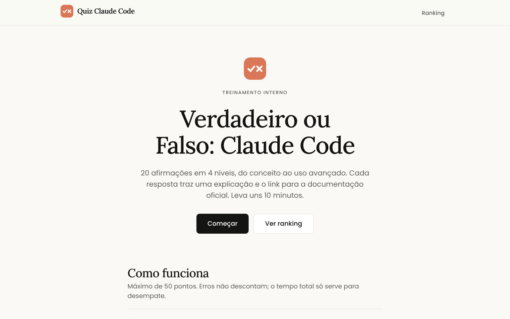
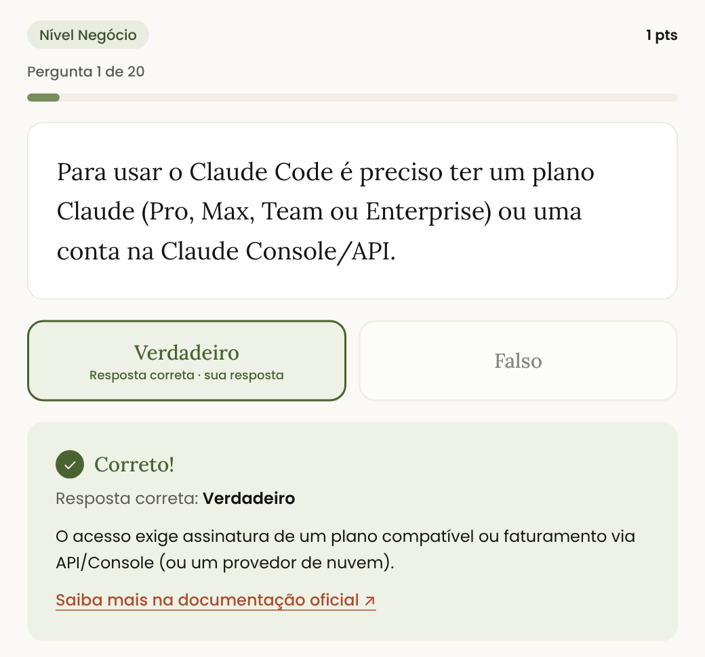
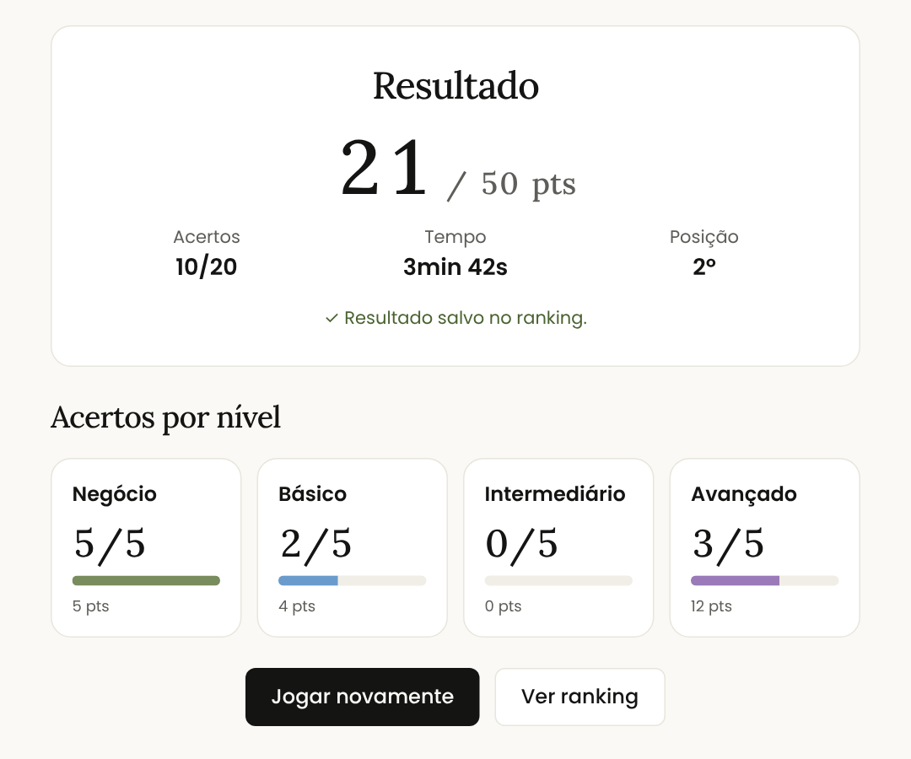
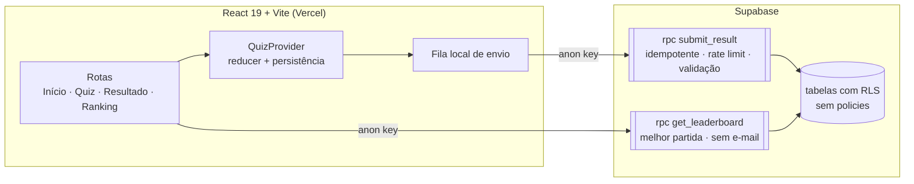

<div align="center">


# Quiz Claude Code · Verdadeiro ou Falso

**Treinamento gamificado sobre o Claude Code: 4 níveis, explicação com link para a documentação oficial e ranking global com regras validadas no banco**

[](https://quiz-claude-ten.vercel.app)
[](https://github.com/gilbertosales/Quiz-claude/actions/workflows/ci.yml)




</div>

---

## 🎯 Sobre

Quiz de treinamento sobre o **Claude Code**, pensado para times que estão adotando a ferramenta. Cada partida tem **20 afirmações de verdadeiro ou falso**, sorteadas de um banco de 60 e divididas em 4 níveis: Negócio, Básico, Intermediário e Avançado. Depois de cada resposta aparece uma explicação curta com o link para a documentação oficial, então a pessoa aprende enquanto joga.

O projeto foi construído com o **próprio Claude Code**, a partir de um PRD completo ([`.claude/prd.md`](./.claude/prd.md)), de um `CLAUDE.md` e de skills do projeto.

<div align="center">

&nbsp;

</div>

## ✨ Destaques

|                         |                                                                                                                                                      |
| ----------------------- | ---------------------------------------------------------------------------------------------------------------------------------------------------- |
| 📈 **Pontos por nível** | Negócio vale 1, Básico 2, Intermediário 3 e Avançado 4 (máximo de 50). Erros não descontam, e o tempo total só desempata                             |
| 💡 **Aprender jogando** | Explicação e link para a documentação em cada resposta, revisão completa no final e uma tela de transição entre os níveis                            |
| 🏆 **Ranking seguro**   | O front só usa a chave `anon`. Toda leitura e escrita passa por funções `security definer`, com tabelas em RLS e **sem policies**                    |
| 🛡️ **Regras no banco**  | Envio idempotente (`client_game_id`), rate limit por e-mail, validação de duração e pontuação, e ranking que não expõe e-mails                       |
| 📶 **Resiliente**       | Partida retomável depois de recarregar a página. Se o envio falhar, o resultado entra numa fila local e é reenviado depois                           |
| ⌨️ **Acessível**        | Dá para jogar só pelo teclado (`V`, `F`, `Enter`), com regras `jsx-a11y` no lint e layout testado em 360 px                                          |
| ✅ **Qualidade**        | 96 testes no Vitest (reducer, pontuação, sorteio, persistência, envio, validação do banco de perguntas) e E2E com Playwright no desktop e no celular |

## 🏗️ Arquitetura



---

## 🛠️ Desenvolvimento

### Setup local

```bash
npm install
cp .env.example .env.local   # preencha as variáveis (veja abaixo)
npm run dev                  # http://localhost:5173
```

Sem as variáveis do Supabase, o quiz funciona normalmente. O ranking aparece como indisponível, e o resultado fica guardado na fila local de reenvio.

### Variáveis de ambiente

| Variável                     | Descrição                                                                                                   |
| ---------------------------- | ----------------------------------------------------------------------------------------------------------- |
| `VITE_SUPABASE_URL`          | URL do projeto Supabase                                                                                     |
| `VITE_SUPABASE_ANON_KEY`     | Chave `anon` (pública; o acesso é limitado por RLS e RPC)                                                   |
| `VITE_ALLOWED_EMAIL_DOMAINS` | Domínios aceitos, separados por vírgula (ex.: `empresa.com,empresa.com.br`). Vazio aceita qualquer domínio. |
| `VITE_APP_VERSION`           | Versão gravada em cada partida                                                                              |

### Scripts

| Comando                             | O que faz                                              |
| ----------------------------------- | ------------------------------------------------------ |
| `npm run dev`                       | Servidor de desenvolvimento                            |
| `npm run build` / `npm run preview` | Build de produção (`dist/`) e preview local            |
| `npm run typecheck`                 | `tsc -b`                                               |
| `npm run lint`                      | oxlint (inclui regras `jsx-a11y`)                      |
| `npm run format`                    | Prettier                                               |
| `npm test`                          | Testes unitários e de integração (Vitest)              |
| `npm run test:e2e`                  | E2E com Playwright (Supabase mockado; desktop e 360px) |

Para rodar um único teste: `npx vitest run src/features/quiz/scoring.test.ts` ou `npx playwright test -g "retoma a partida"`. Na primeira vez, instale o navegador do E2E com `npx playwright install chromium`.

### Supabase

> 📖 **Primeira vez?** Siga o guia ilustrado [`docs/SUPABASE.md`](./docs/SUPABASE.md), com prints de onde clicar e de onde copiar a URL e a chave.

A migração está em [`supabase/migrations/0001_init.sql`](./supabase/migrations/0001_init.sql). O front só usa a chave `anon`: as tabelas têm RLS e não têm policies, e toda leitura e escrita passa pelas funções `submit_result` e `get_leaderboard` (`security definer`).

```bash
npx supabase login
npx supabase link --project-ref <ref-do-projeto>
npx supabase db push
```

Depois, cadastre os domínios permitidos no SQL Editor. Eles devem espelhar `VITE_ALLOWED_EMAIL_DOMAINS`; com a tabela vazia, o banco aceita qualquer domínio:

```sql
insert into public.allowed_domains (domain) values ('empresa.com'), ('empresa.com.br');
```

Regras aplicadas no banco:

- **Envio idempotente:** cada partida tem um `client_game_id` gerado no navegador. Reenviar a mesma partida devolve o id já gravado, sem duplicar.
- **Rate limit:** 1 envio por e-mail a cada 60 s, serializado por e-mail (sem corrida entre envios simultâneos).
- **Validação:** partida entre 10 s e 2 h, exatamente 20 perguntas, e `score` / `correct_count` coerentes com os acertos por nível.
- **Ranking:** melhor partida por e-mail, sem expor o e-mail, com no máximo 100 linhas por consulta.
- **"Você" no ranking:** a pessoa é reconhecida pelos ids de partida que o navegador recebeu no envio, nunca pelo e-mail. Por isso não dá para consultar a posição de outra pessoa a partir do e-mail dela.

> **Risco aceito (v1):** a pontuação é calculada no cliente. Veja a §7.5 do PRD.

### Deploy na Vercel

> 📖 **Primeira vez?** Siga o guia ilustrado [`docs/VERCEL.md`](./docs/VERCEL.md), com prints de cada tela, as variáveis e os erros mais comuns.

- Framework preset: **Vite**. Build: `npm run build`. Output: `dist`.
- O `vercel.json` já tem o rewrite de SPA.
- Configure as quatro variáveis `VITE_*` em **Production** e **Preview**.

### Ferramenta para prints de tutoriais

Os guias em `docs/` usam prints anotados com a ferramenta **🖍️ Destacar Prints** (caixas numeradas, desfoque e textos escondidos, direto no navegador). Veja como instalar e usar em [`docs/ferramentas/`](./docs/ferramentas/).

### Banco de perguntas

As perguntas ficam em `src/data/questions.json` e são validadas por `src/data/questions.test.ts`: schema Zod, IDs únicos, ≥ 5 por nível, `docUrl` com `https://` e entre 30% e 70% de "Verdadeiro" por nível.

⚠️ **Revisão pendente.** O conteúdo veio da §9 do PRD e precisa ser revisado pelo time, com validação de cada link. Para cumprir a regra de equilíbrio V/F, sete afirmações verdadeiras foram reescritas como falsas e marcadas com a tag `"revisar"`:

| ID       | Nova afirmação (Falso)                                    |
| -------- | --------------------------------------------------------- |
| `bas-07` | `Esc` encerra a sessão e apaga a conversa                 |
| `bas-11` | `claude --continue` abre um seletor de conversas          |
| `int-01` | No Plan Mode, o Claude edita arquivos sem pedir aprovação |
| `int-04` | `.claude/settings.local.json` deve ser versionado         |
| `int-14` | O Claude Code não consegue analisar imagens               |
| `ava-04` | No modo `-p` não existe saída JSON                        |
| `ava-09` | Entre `allow` e `deny`, a regra `allow` prevalece         |

---

<div align="center">
Feito por <a href="https://github.com/gilbertosales">Gilberto Sales</a> · <a href="https://www.linkedin.com/in/gilberto-gomes-de-sales-3a979651">LinkedIn</a> · Não é um produto oficial da Anthropic.
</div>
