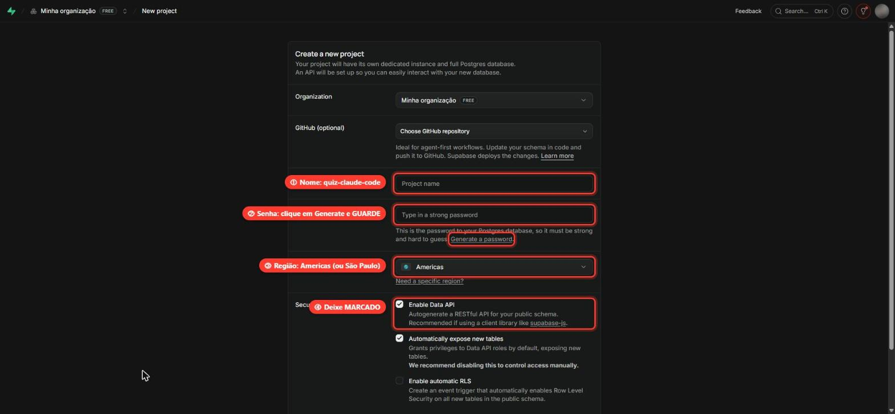
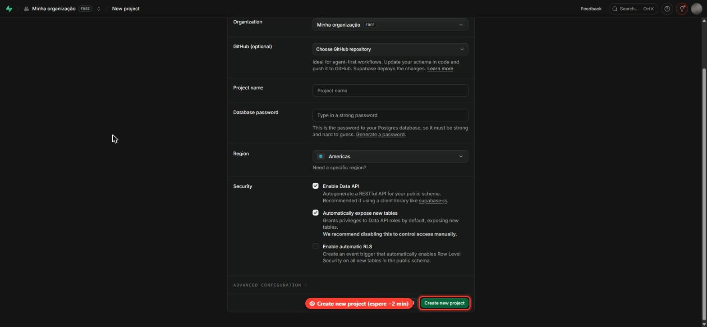
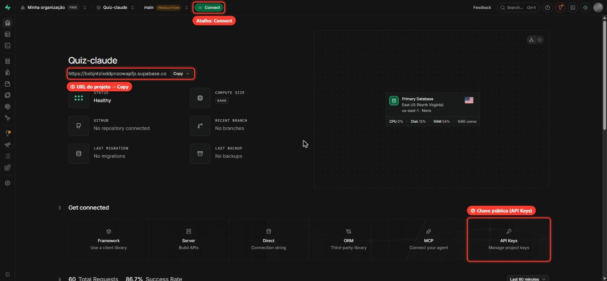
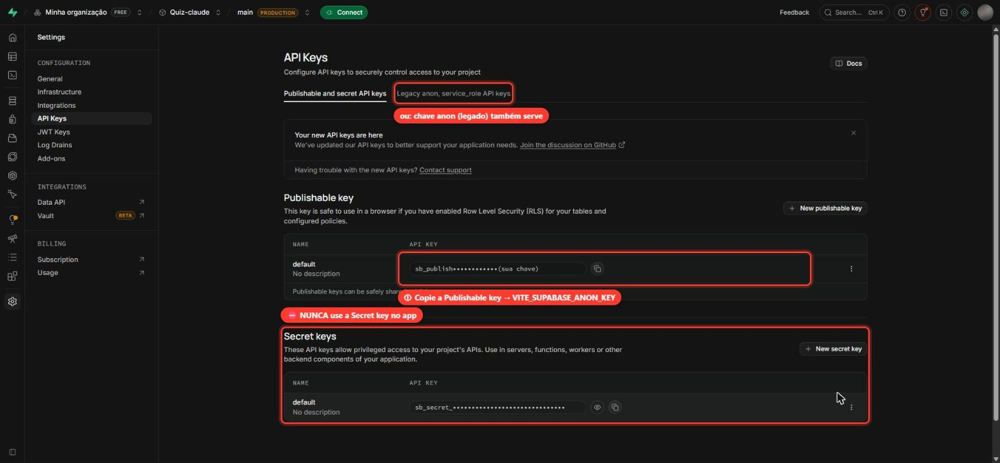
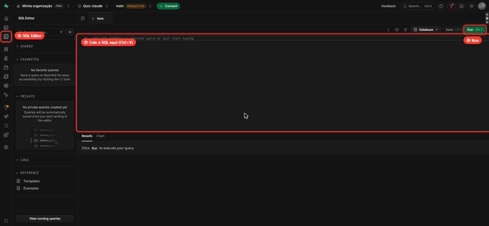
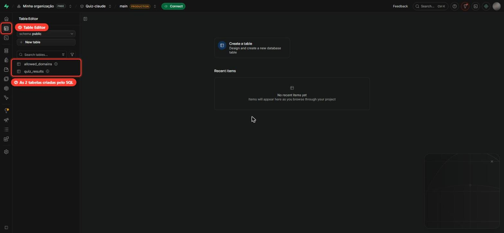
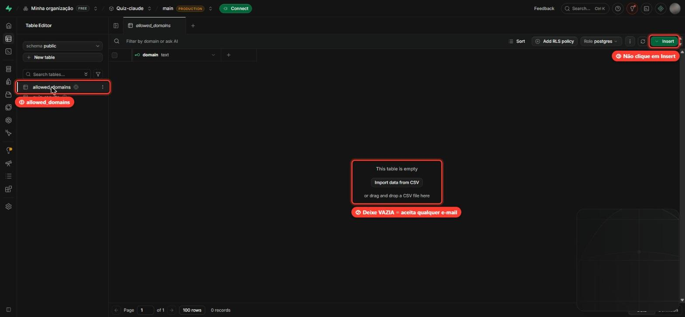

# Configurando o Supabase: passo a passo

Este guia mostra como criar o banco de dados do **Quiz Claude Code** no Supabase e ligar o app a ele. Leva uns **10 minutos** e não exige conhecimento de banco de dados.

> 📌 **Resumo do que você vai fazer**
>
> 1. Criar um projeto no Supabase
> 2. Copiar a **URL** e a **chave pública** do projeto
> 3. Rodar um arquivo SQL que cria as tabelas
> 4. Colar a URL e a chave no arquivo `.env.local` do app
> 5. Testar

Nos prints, os destaques vermelhos numerados (①, ②…) mostram onde clicar. As chaves aparecem mascaradas (`••••`) de propósito.

---

## Antes de começar

- Uma conta no **[supabase.com](https://supabase.com)** (gratuita; dá para entrar com a conta do GitHub).
- O projeto do quiz baixado no seu computador.

---

## Passo 1: Criar o projeto

1. Entre em **[supabase.com/dashboard](https://supabase.com/dashboard)** e clique em **New project**.
2. Preencha o formulário:



| #   | Campo                 | O que colocar                                                                                                                                                      |
| --- | --------------------- | ------------------------------------------------------------------------------------------------------------------------------------------------------------------ |
| ①   | **Project name**      | `quiz-claude-code` (ou o nome que preferir)                                                                                                                        |
| ②   | **Database password** | Clique em **Generate a password** e **guarde a senha** num lugar seguro. O app não usa essa senha, mas você vai precisar dela se um dia for mexer direto no banco. |
| ③   | **Region**            | **Americas** (ou, em _Need a specific region?_, **South America (São Paulo)**, que fica mais perto)                                                                |
| ④   | **Enable Data API**   | **Deixe marcado.** O app conversa com o banco por essa API.                                                                                                        |

As outras opções podem ficar como estão.

3. Role a página até o fim e clique em **Create new project** ⑤:



⏳ O Supabase leva **cerca de 2 minutos** para preparar o banco. Espere até a página do projeto aparecer com o status **Healthy**.

---

## Passo 2: Copiar a URL do projeto

Na página inicial do projeto, a URL já aparece logo abaixo do nome, com um botão **Copy** ①:



1. Clique em **Copy** ① e guarde o valor. Ele tem este formato:

   ```
   https://abcdefghijklmno.supabase.co
   ```

> ⚠️ **Copie só até o `.co`.** Se aparecer `/rest/v1/` no final, apague esse trecho. Com ele, o app não consegue falar com o banco.

2. Na mesma página, em **Get connected**, clique no card **API Keys** ② para ir ao próximo passo.

> 💡 O botão verde **Connect**, no topo, é um atalho que mostra a URL e a chave juntas, já no formato de variáveis.

---

## Passo 3: Copiar a chave pública

A página **API Keys** mostra dois tipos de chave. **Só uma delas pode ir para o app:**



1. Em **Publishable key**, clique no ícone de copiar ao lado da chave ①. Ela começa com `sb_publishable_`.
   - Essa chave **pode** ficar no navegador: o banco está protegido por regras de acesso (RLS).
   - Também serve a chave **anon** da aba **Legacy anon, service_role API keys** (começa com `eyJ…`). Use uma ou outra.

> ⛔ **Nunca use a _Secret key_** (nem a `service_role` da aba Legacy). Ela dá acesso total ao banco, ignorando todas as proteções. Não a coloque no app, no GitHub, na Vercel nem em mensagens.

---

## Passo 4: Criar as tabelas (rodar o SQL)

O app precisa de duas tabelas e duas funções, que já estão prontas no arquivo **`supabase/migrations/0001_init.sql`** do projeto.

1. No seu computador, abra `supabase/migrations/0001_init.sql`, selecione tudo (**Ctrl+A**) e copie (**Ctrl+C**).
2. No Supabase, clique em **SQL Editor** ① no menu da esquerda (ícone `>_`):



3. Clique dentro do editor ② e cole (**Ctrl+V**).
4. Clique em **Run** ③ (ou **Ctrl+Enter**).
5. Deve aparecer, embaixo: **`Success. No rows returned`** ✅

> Se aparecer um aviso de _"destructive operation"_, pode confirmar. Ele aparece por causa dos comandos `revoke`, que **tiram** permissões de acesso direto às tabelas (é isso que deixa o banco seguro).

### Conferindo

Clique em **Table Editor** ① no menu da esquerda. As duas tabelas ② devem aparecer:



| Tabela            | Para que serve                         |
| ----------------- | -------------------------------------- |
| `quiz_results`    | Guarda cada partida jogada             |
| `allowed_domains` | Lista de domínios de e-mail permitidos |

---

## Passo 5: Deixar `allowed_domains` vazia

A tabela `allowed_domains` define **quais e-mails podem jogar** (por exemplo, só `@suaempresa.com`).

**Se vocês não têm e-mail corporativo, deixe essa tabela vazia ②.** Vazia significa _qualquer e-mail é aceito_ (Gmail, Outlook etc.). Não clique em **Insert** ③.



<details>
<summary>Quero restringir a um domínio da empresa</summary>

No **SQL Editor**, rode (trocando pelo seu domínio):

```sql
insert into public.allowed_domains (domain) values ('suaempresa.com');
```

E coloque o mesmo domínio em `VITE_ALLOWED_EMAIL_DOMAINS`, no passo 6. Os dois precisam bater.

</details>

---

## Passo 6: Ligar o app ao Supabase (`.env.local`)

1. Na **pasta raiz do projeto** (a mesma do `package.json`), crie um arquivo chamado **`.env.local`**. O jeito mais fácil é copiar o modelo:

   ```bash
   copy .env.example .env.local
   ```

2. Abra o `.env.local` e preencha **logo depois do `=`**, sem aspas e sem espaços:

   ```env
   VITE_SUPABASE_URL=https://abcdefghijklmno.supabase.co
   VITE_SUPABASE_ANON_KEY=sb_publishable_xxxxxxxxxxxxxxxx
   VITE_ALLOWED_EMAIL_DOMAINS=
   VITE_APP_VERSION=1.0.0
   ```

   | Variável                     | De onde vem                               |
   | ---------------------------- | ----------------------------------------- |
   | `VITE_SUPABASE_URL`          | Passo 2 (a URL, **sem** `/rest/v1/`)      |
   | `VITE_SUPABASE_ANON_KEY`     | Passo 3 (a **Publishable** ou a **anon**) |
   | `VITE_ALLOWED_EMAIL_DOMAINS` | **Vazio** (veja o passo 5)                |
   | `VITE_APP_VERSION`           | Deixe `1.0.0`                             |

> ⚠️ Não copie os valores de exemplo do `.env.example` (`empresa.com,empresa.com.br`) para `VITE_ALLOWED_EMAIL_DOMAINS`. Com eles, o app recusaria o e-mail de todo mundo.

> 🔒 O `.env.local` **não vai para o GitHub**: ele já está no `.gitignore`.

---

## Passo 7: Testar

1. No terminal, na pasta do projeto:

   ```bash
   npm run dev
   ```

   Se o app já estava rodando, pare com **Ctrl+C** e rode de novo. Ele só lê o `.env.local` ao iniciar.

2. Abra **http://localhost:5173**, clique em **Começar** e jogue uma partida.
3. No final deve aparecer **"✓ Resultado salvo no ranking"**, e o seu nome aparece em **Ranking** como _(você)_. 🎉

> ⏱️ Partidas feitas em **menos de 10 segundos** são recusadas de propósito (proteção contra robôs). Para testar, jogue com calma.

---

## Publicando na Vercel

A Vercel **não lê** o seu `.env.local`. Lá você cadastra as mesmas variáveis pela tela:

1. No projeto da Vercel, vá em **Settings → Environment Variables**.
2. Cadastre `VITE_SUPABASE_URL`, `VITE_SUPABASE_ANON_KEY` e `VITE_APP_VERSION`, com os mesmos valores do `.env.local`, marcando **Production** e **Preview**.
3. Se o site já tinha sido publicado, faça um **Redeploy**: as variáveis só passam a valer num build novo.

---

## Deu erro? Veja aqui

| O que aparece                                                      | Causa provável                                                    | Como resolver                                             |
| ------------------------------------------------------------------ | ----------------------------------------------------------------- | --------------------------------------------------------- |
| _"O ranking não está configurado neste ambiente"_                  | O `.env.local` não existe, está vazio ou o app não foi reiniciado | Confira o passo 6 e reinicie o `npm run dev`              |
| _"Não foi possível conectar ao servidor"_ ou o ranking não carrega | URL com `/rest/v1/` no final, ou URL/chave com aspas ou espaços   | Deixe a URL terminando em `.supabase.co`, sem aspas       |
| Erro `PGRST202` ou `PGRST205` (_"Could not find…"_)                | O SQL do passo 4 não foi rodado                                   | Rode o `0001_init.sql` no SQL Editor                      |
| _"Este domínio de e-mail não pode participar do ranking"_          | Há domínios cadastrados em `allowed_domains`                      | Esvazie a tabela (passo 5) ou use um e-mail desse domínio |
| _"Use seu e-mail corporativo…"_ no formulário                      | `VITE_ALLOWED_EMAIL_DOMAINS` preenchida                           | Deixe a variável vazia e reinicie o app                   |
| _"O resultado foi recusado pelo servidor"_                         | Partida em menos de 10 s                                          | Jogue de novo com calma                                   |
| _"Muitos envios seguidos"_                                         | Duas partidas com o mesmo e-mail em menos de 60 s                 | Espere um minuto; o app reenvia sozinho                   |

---

## Por que o banco é seguro com uma chave "pública"?

A chave do app é pública de propósito: ela vai para o navegador de quem joga. A segurança está no próprio banco:

- As tabelas têm **RLS** ativado e **nenhuma permissão de acesso direto**. Com a chave pública, ninguém consegue ler nem alterar as tabelas.
- O app só consegue chamar **duas funções**: `submit_result`, que grava uma partida depois de validá-la, e `get_leaderboard`, que lê o ranking **sem e-mails**.
- O banco recusa resultados incoerentes (pontuação que não bate com os acertos), envios repetidos e partidas rápidas demais.

Por isso a **Secret key** nunca pode ser usada no app: ela passaria por cima de todas essas proteções.
