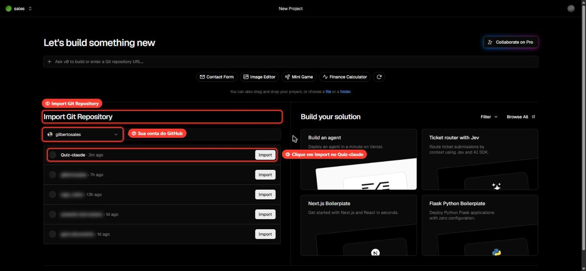
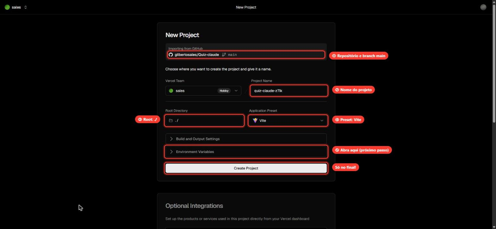
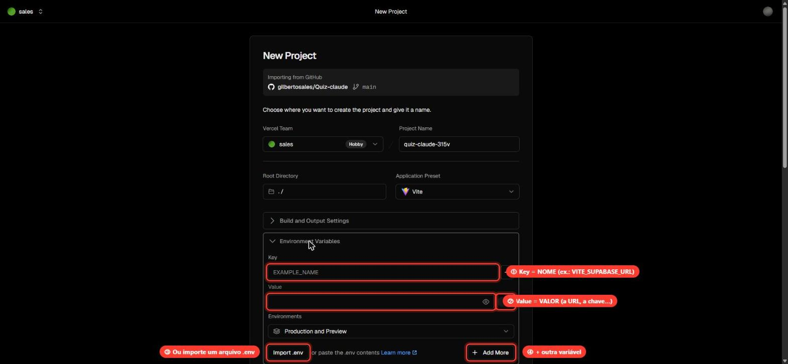
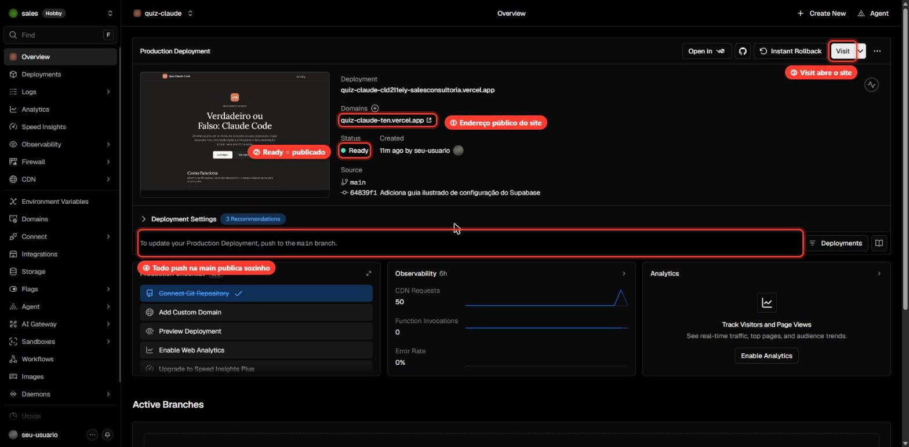
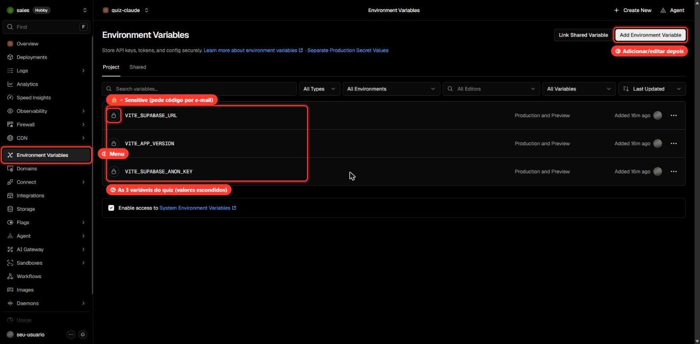
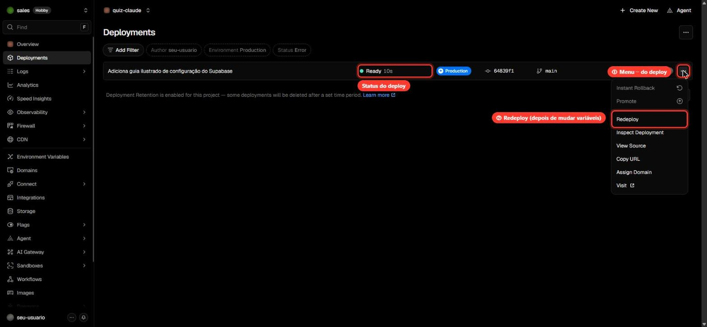
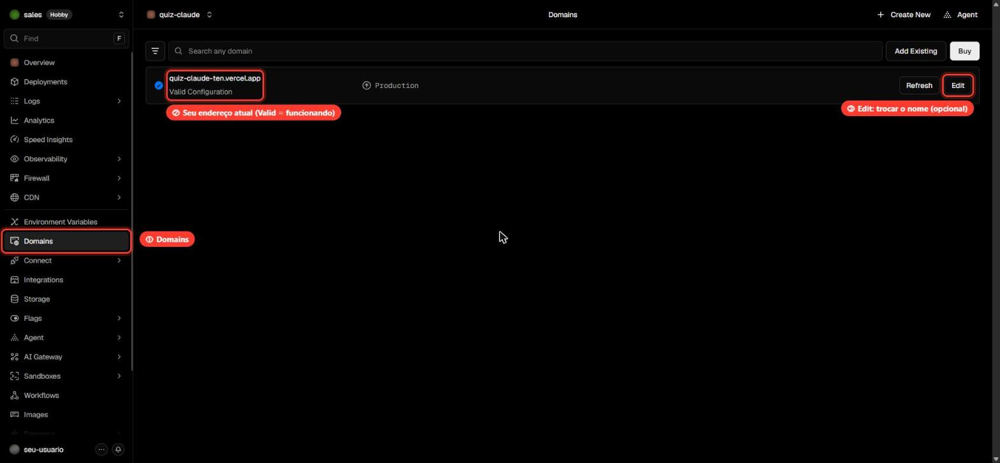

# Publicando na Vercel: passo a passo

Este guia coloca o **Quiz Claude Code** no ar, num endereço público como `https://quiz-claude-xxx.vercel.app`, de graça. Leva uns **10 minutos**.

> 📌 **Resumo do que você vai fazer**
>
> 1. Entrar na Vercel com a conta do GitHub
> 2. Importar o repositório do quiz
> 3. Cadastrar as 3 variáveis de ambiente (as mesmas do `.env.local`)
> 4. Clicar em **Create Project** e confirmar o código que chega por e-mail
> 5. Abrir o site e testar

Nos prints, os destaques vermelhos numerados (①, ②…) mostram onde clicar. Dados pessoais aparecem borrados de propósito.

---

## Antes de começar

Você precisa de:

- ✅ O **Supabase configurado**, com a URL e a chave pública em mãos. Se ainda não fez, siga o [`SUPABASE.md`](./SUPABASE.md).
- ✅ O código do quiz **no GitHub**. A Vercel publica a partir de um repositório.
- ✅ Uma conta na **[vercel.com](https://vercel.com)**. Use **Continue with GitHub** e o plano **Hobby**, que é gratuito.

> 💡 Teste o app no seu computador antes (`npm run dev`, passo 7 do guia do Supabase). Se funcionar aí, vai funcionar na Vercel.

---

## Passo 1: Importar o repositório

1. Abra **[vercel.com/new](https://vercel.com/new)**.
2. Em **Import Git Repository** ①, confira se a sua conta do GitHub ② está selecionada.
3. Na linha do **Quiz-claude**, clique em **Import** ③.



> **O repositório não aparece?** Clique em **Adjust GitHub App Permissions** (logo abaixo da lista) e libere o acesso da Vercel ao repositório `Quiz-claude`.

---

## Passo 2: Conferir a configuração

A Vercel detecta quase tudo sozinha. Só confira:



| #   | Campo                     | O que deve estar                                             |
| --- | ------------------------- | ------------------------------------------------------------ |
| ①   | **Importing from GitHub** | `gilbertosales/Quiz-claude`, branch `main`                   |
| ②   | **Project Name**          | O nome do projeto, que vira parte do endereço do site        |
| ③   | **Root Directory**        | `./` (não mude)                                              |
| ④   | **Application Preset**    | **Vite** (detectado automaticamente)                         |
| ⑤   | **Environment Variables** | Clique para abrir. É o próximo passo, e é o mais importante. |

> ℹ️ **O nome ganhou um final estranho (ex.: `quiz-claude-z7lk`)?** É porque já existe um projeto com esse nome na sua conta. Se for a primeira vez que você publica, vai aparecer só `quiz-claude`.

> ⚠️ **Ainda não clique em Create Project.** Primeiro cadastre as variáveis (passo 3). Sem elas, o site sobe sem o ranking.

---

## Passo 3: Cadastrar as variáveis de ambiente

As variáveis dizem ao site **qual banco do Supabase usar**. São as mesmas do seu arquivo `.env.local`.

Ao abrir **Environment Variables**, aparecem dois campos para cada variável:



| #   | Campo           | O que vai nele                                               |
| --- | --------------- | ------------------------------------------------------------ |
| ①   | **Key**         | O **nome** da variável, exatamente como na tabela abaixo     |
| ②   | **Value**       | O **valor** da variável                                      |
| ③   | **Import .env** | Alternativa: carrega todas de uma vez a partir de um arquivo |
| ④   | **Add More**    | Abre mais um par Key/Value                                   |

**Cadastre estas 3 variáveis**, uma por linha:

| Key (nome)               | Value (valor)                  | De onde vem                                      |
| ------------------------ | ------------------------------ | ------------------------------------------------ |
| `VITE_SUPABASE_URL`      | `https://xxxxxxxx.supabase.co` | Supabase, passo 2 (**sem** `/rest/v1/` no final) |
| `VITE_SUPABASE_ANON_KEY` | `sb_publishable_…` ou `eyJ…`   | Supabase, passo 3 (a chave **pública**)          |
| `VITE_APP_VERSION`       | `1.0.0`                        | Sempre `1.0.0`                                   |

Como fazer:

1. No campo **Key** ①, digite `VITE_SUPABASE_URL`.
2. No campo **Value** ②, cole a URL do Supabase.
3. Clique em **Add More** ④ e repita para as outras duas.

> ❌ **Erro comum:** colar a URL no campo **Key**. A Vercel recusa com a mensagem _"Environment variable "https://…" is invalid"_. A URL vai no **Value**; no **Key** vai só o nome `VITE_SUPABASE_URL`.

> ⛔ **Nunca cadastre a _Secret key_ / `service_role` do Supabase.** Só a chave pública.

> 🚫 **Não cadastre `VITE_ALLOWED_EMAIL_DOMAINS`.** Sem ela, o quiz aceita qualquer e-mail (Gmail, Outlook…), que é o que queremos quando não há e-mail corporativo.

<details>
<summary>💡 Atalho: importar de um arquivo (para quem não consegue colar)</summary>

1. Crie, na pasta do projeto, um arquivo de texto chamado `vercel.env` com as 3 linhas:

   ```env
   VITE_SUPABASE_URL=https://xxxxxxxx.supabase.co
   VITE_SUPABASE_ANON_KEY=sua-chave-publica
   VITE_APP_VERSION=1.0.0
   ```

2. Clique em **Import .env** ③ e escolha esse arquivo. As 3 variáveis aparecem preenchidas.
3. Depois do deploy, **apague o `vercel.env`**. Ele já está no `.gitignore` e não vai para o GitHub, mas é melhor não deixar cópias da chave por aí.

</details>

---

## Passo 4: Create Project e o código por e-mail

1. Com as 3 variáveis preenchidas, clique em **Create Project**.

   > Na versão atual da Vercel **não existe mais um botão "Deploy" separado**: o **Create Project** cria o projeto e já publica.

2. Vai aparecer uma janela **Reauthenticate** pedindo um código. **Isso é normal:** é uma verificação de segurança, porque você está salvando uma chave.
   1. Clique em **Send Code to Email**.
   2. Abra o e-mail **da sua conta da Vercel** e procure a mensagem da Vercel. Olhe também em **Promoções**, **Atualizações** e **Spam**.
   3. Digite os 6 dígitos e clique em **Verify**.

   > 📬 **O e-mail não chega?** Talvez você esteja olhando a caixa errada. Confira qual é o e-mail principal da conta em **[vercel.com/account/settings](https://vercel.com/account/settings)**. Ele pode ser diferente do e-mail que você usa no GitHub ou no git.

   > ❗ **Não clique em Cancel** nessa janela, senão as variáveis podem não ser salvas.

3. Espere ~1 minuto. Aparece **"Deployed to Production"** 🎉.
4. A Vercel ainda oferece **Add Domain** e **Enable Speed Insights**. **Os dois são opcionais e podem ser ignorados.**

---

## Passo 5: Encontrar o endereço do site

Clique em **Continue to Project** (ou abra o projeto em [vercel.com](https://vercel.com)). Na página do projeto:



| #   | O que é                                                                             |
| --- | ----------------------------------------------------------------------------------- |
| ①   | **Domains:** o **endereço público** do site. **É esse que você manda para o time.** |
| ②   | **Status Ready:** o site está publicado e funcionando                               |
| ③   | **Visit:** abre o site                                                              |
| ④   | Daqui em diante, **todo `git push` na branch `main` publica sozinho**, em ~1 minuto |

> ⚠️ **Use o endereço que aparece em Domains, não um "parecido".** Se o nome `quiz-claude.vercel.app` já pertence a outra pessoa, a Vercel acrescenta um sufixo (ex.: `quiz-claude-ten.vercel.app`). O endereço `quiz-claude.vercel.app`, sem o sufixo, **seria o site de outra pessoa**.

> ℹ️ O endereço em **Deployment** (algo como `quiz-claude-abc123-….vercel.app`) é o de **uma versão específica** e pode pedir login. Para o time, use sempre o de **Domains**.

---

## Passo 6: Testar o site publicado

1. Abra o endereço de **Domains**.
2. Clique em **Ver ranking**. Ele deve carregar, mesmo vazio, **sem** a mensagem _"O ranking não está configurado"_.
3. Jogue uma partida. No final deve aparecer **"✓ Resultado salvo no ranking"**.

> 💡 O ranking do site publicado é **o mesmo** do seu computador, porque os dois usam o mesmo banco do Supabase. As partidas que você jogou em `localhost` também aparecem lá.

---

## Depois: mudar uma variável (e o Redeploy)

Se precisar trocar uma variável (por exemplo, uma chave nova do Supabase):

1. No projeto, abra **Environment Variables** ① no menu da esquerda. As variáveis ② aparecem com o valor escondido.
2. Use **Add Environment Variable** ③ para criar uma nova, ou os **⋯** no fim da linha para editar ou remover.



> 🔒 O **cadeado** indica uma variável _Sensitive_: o valor nunca mais aparece na tela, e criar ou editar pede o código por e-mail. Para a URL e a chave **pública** do Supabase, o cadeado não é necessário, porque esses valores já ficam visíveis dentro do próprio site.

**Importante:** mudar uma variável **não atualiza o site sozinho**. As variáveis `VITE_*` entram no site no momento do build. Depois de mudar, faça um **Redeploy**:

1. Abra **Deployments** no menu da esquerda.
2. No deploy mais recente, clique nos **⋯** ①.
3. Clique em **Redeploy** ② e confirme.



Em ~1 minuto o status volta a ficar **Ready**, já com as variáveis novas.

---

## Opcional: trocar o endereço do site

Não gostou do `-ten` (ou de outro sufixo) no endereço? Dá para trocar por outro nome `.vercel.app` que esteja livre:

1. Abra **Domains** ① no menu da esquerda.
2. Seu endereço atual ② aparece com **Valid Configuration**, ou seja, funcionando.
3. Clique em **Edit** ③ e digite outro nome, por exemplo `quiz-claude-code-suaempresa.vercel.app`.



> Se o nome já estiver em uso, a Vercel avisa. Ao trocar, o endereço antigo para de funcionar: avise o time do novo link.

---

## Deu erro? Veja aqui

| O que aparece                                                    | Causa provável                                      | Como resolver                                                                                   |
| ---------------------------------------------------------------- | --------------------------------------------------- | ----------------------------------------------------------------------------------------------- |
| _"Environment variable "https://…" is invalid"_                  | A URL foi colada no campo **Key**                   | No **Key** vai o nome (`VITE_SUPABASE_URL`); a URL vai no **Value**                             |
| Não consigo colar no campo                                       | Bloqueio do navegador ou da página                  | Clique com o **botão direito → Colar**, ou use o **Import .env** (passo 3)                      |
| Não acho o botão **Deploy**                                      | Na Vercel nova ele não existe                       | Use **Create Project**, que cria e publica                                                      |
| Janela **Reauthenticate** pedindo código                         | Verificação de segurança normal                     | **Send Code to Email** e digite o código. Veja o e-mail **da conta da Vercel**.                 |
| Site abre, mas _"O ranking não está configurado neste ambiente"_ | Variáveis faltando, ou cadastradas depois do deploy | Confira as 3 variáveis e faça um **Redeploy**                                                   |
| Site abre, mas _"Não foi possível conectar ao servidor"_         | URL com `/rest/v1/` ou chave errada                 | Corrija em **Environment Variables** e faça **Redeploy**                                        |
| O endereço abre um **site de outra pessoa**                      | Você usou `quiz-claude.vercel.app` sem o sufixo     | Use o endereço que aparece em **Domains** (passo 5)                                             |
| O endereço pede **login da Vercel**                              | Você abriu o link de um deploy específico           | Use o endereço de **Domains**                                                                   |
| Criei um projeto a mais sem querer                               | Clique duplo ou repetido em **Create Project**      | Abra o projeto extra → **Settings** → fim da página → **Delete Project**. Confira o nome antes! |

---

## Resumo: o que fica onde

| Onde               | O quê                                                                |
| ------------------ | -------------------------------------------------------------------- |
| **GitHub**         | O código do quiz. Cada `git push` na `main` publica uma versão nova. |
| **Vercel**         | O site no ar e as 3 variáveis (URL, chave pública e versão)          |
| **Supabase**       | O banco com as partidas e o ranking                                  |
| **Seu computador** | O `.env.local` (só para testar localmente; nunca vai para o GitHub)  |
